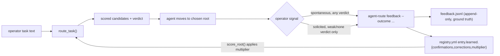

# Agent-route feedback loop — adaptive per-entry scoring from operator confirm/correct/reject signals

**Version:** v1
**Status:** DRAFT — 2026-08-06. Awaiting operator review/approval.
**Date:** 2026-08-06
**Owning repository:** `skills` (`KleinPerkins/skills`)
**Review provenance:** Co-designed live with the operator during an `agent-route` routing session
on 2026-08-06: the operator confirmed a `weak`-verdict routing decision was in fact correct, then
asked that this class of signal be used to calibrate future routing. The two governing design
choices below — a per-entry multiplier over global weight tuning, and a hybrid capture trigger —
were operator-selected among explicit alternatives presented in-session; see `Supersedes:` in any
future revision for what, if anything, changed on review. Formalized into this plan plus
`docs/adr/0001-agent-route-feedback-loop.md` per the `doc-warden` documentation convention
(itself modeled on `personal/pr-automation-controller/docs/{adr,plans}/`) at operator request.

---

## 1. Purpose

`agent-route` scores routing candidates via pure, deterministic keyword-overlap
([`lib/score.py`](../../global/skills/agent-route/lib/score.py)) with no memory of past routing
outcomes. Its `reconcile` verb only emits static heuristic suggestions ("this inferred entry has a
purpose, consider pinning") that never consume an actual outcome signal. There is currently no way
for an operator's "yes, that was right" or "no, it should have been X" to durably change anything.
This plan closes that loop: it lets real operator feedback narrow future close calls between
registry entries, without weakening the tool's existing deterministic, fully-explainable scoring
design (every score must remain traceable to a `why` string).

## 2. Scope and non-goals

**In scope:**
- An append-only, machine-local feedback log (`~/.agent-route/feedback.jsonl`).
- A per-registry-entry `learned` block (confirmations/corrections/rejections → a clamped score
  multiplier) that survives registry rebuilds.
- Integration of that multiplier into `score_root()`, with `why`-string transparency.
- A new `agent-route feedback` CLI verb to record confirm/correct/reject outcomes.
- A `reconcile` enhancement that surfaces learned-history evidence, especially contradictory
  history (both confirmations and corrections-away for the same entry).
- Documentation updates (`SKILL.md`, `README.md`) describing the hybrid capture flow.
- Unit test coverage for all of the above; `make verify` stays green throughout.

**Explicitly out of scope (non-goals — see `docs/adr/0001-agent-route-feedback-loop.md` §Why for the
evidence behind each):**
- Tuning `agent-route`'s global weight constants (`W_KEYWORD`, `W_ALIAS`, `W_DOMAIN`, etc.) from
  feedback — statistically unsound at this tool's data volume (single-digit-to-low-tens
  events/week across ~150 unrelated registry roots).
- Semi-automatic auto-writing of new keywords/aliases from feedback text — stays a human/agent
  action via `reconcile`'s existing suggestion surface.
- Cross-session recall of routing decisions the current agent has no conversational access to.
- Query-pattern-scoped learning — the multiplier is per-root, not per-(root, query-shape).

## 3. Background and context

Verified against this worktree at the time of authoring (`skills` @ `9be3206`):

- `agent-route` is a `global`-scope, `flavor: 1` capability owned by `KleinPerkins`
  (`global/skills/agent-route/meta.yml`), symlinked into `~/.cursor/skills/agent-route` (and the
  Claude/Codex equivalents) from this repo, its real source.
- Machine-local state (`registry.yml`, `index.json`, discoveries, install manifest) lives under
  `~/.agent-route/` (`STATE_DIR` in
  [`lib/paths.py`](../../global/skills/agent-route/lib/paths.py)), deliberately separate from the
  skill's own read-only shipped payload — the new `feedback.jsonl` belongs alongside `registry.yml`
  and `index.json` as a `STATE_DIR` sibling, for the same reason.
- `score_root()` ([`lib/score.py:172`](../../global/skills/agent-route/lib/score.py)) currently
  computes `raw_score = sum(contributions.values())` (`lib/score.py:249`) from weighted
  keyword/alias/domain/purpose/name/owner/readme/manifest/agents_md/policy contributions, then
  applies only a contributable-penalty adjustment — no feedback signal exists in this path today.
- `merge_overlay()` ([`lib/index_build.py:139`](../../global/skills/agent-route/lib/index_build.py))
  already carries operator-curated fields (`route`, `pin`, `confidence`, etc.) forward, per entry,
  across every `build_registry` rebuild, and `_is_operator_curated()`
  (`lib/index_build.py:118`) decides whether an entry survives being untouched by discovery. The new
  `learned` block reuses this exact carry-forward shape (see §4) without tripping that curated flag.
- `cmd_reconcile()` and `cmd_route()` live in
  [`scripts/agent_route.py`](../../global/skills/agent-route/scripts/agent_route.py) at lines `300`
  and `193` respectively; the new `feedback` verb is added alongside them in the same file.
- **Motivating incident (2026-08-06, this session):** routing the query `"operator-voice"` returned
  a `weak` verdict. First cause — an unrelated staleness bug: the cached index still held 8
  vanished AWA worktree entries tied on score with the canonical checkout; `agent-route discover
  --full` pruned 154→142 roots and fixed that. Second cause, and this plan's actual motivation:
  even after that fix, the canonical `capabilities/operator-voice` (score 55) only barely
  outscored the unrelated `personal/operator-voice-profile` (score 49) — a real, legitimate
  ambiguity between two distinct repos with overlapping keywords, which today's scoring has no
  mechanism to learn from even after the operator explicitly confirms the correct answer.
- Decision record: `docs/adr/0001-agent-route-feedback-loop.md` — per-entry multiplier (not global
  weight tuning), hybrid capture trigger (not passive-only or proactive-only).

## 4. Approach



**Data model — `~/.agent-route/feedback.jsonl`** (new, append-only, machine-local like
`registry.yml`). One JSON line per event, schema-tagged per this workspace's `<name>/v1`
convention:

```json
{"schema": "agent-route-feedback/v1", "ts": "2026-08-06T01:04:00-0700",
 "query": "operator-voice", "verdict": "weak",
 "chosen_abs_path": "/Users/laurence.duggan/dev/capabilities/operator-voice",
 "outcome": "confirmed", "actual_abs_path": null, "note": null}
```

`outcome` is one of `confirmed` (chosen root was right) / `corrected` (wrong; `actual_abs_path`
names the right one) / `rejected` (wrong; correct root unspecified). The log is append-only ground
truth even when a path can no longer be resolved against the live registry.

**Per-entry learned block** (`registry.yml`, engine-managed — never part of the operator-overlay
whitelist):

```yaml
learned:
  confirmations: 2          # chosen + operator said yes
  corrections_toward: 1     # named as the correct answer in someone else's "corrected" event
  corrections_away: 0       # chosen, but operator said "no, it was actually X"
  rejections: 0             # chosen, operator said "no" with no named alternative
  multiplier: 1.10          # derived, clamped
  last_feedback_at: "2026-08-06T01:04:00-0700"
```

Multiplier (pure function, illustrative constants — tunable):
`multiplier = clamp(1.0 + STEP*(confirmations + corrections_toward) - STEP*(corrections_away +
rejections), MIN, MAX)`, e.g. `STEP=0.05`, `MIN=0.6`, `MAX=1.4`. A small per-event nudge, capped so
no single event (or burst of them) can dominate the existing keyword/alias/etc. signal — the
multiplier narrows or widens close margins; it never invents a match from nothing.

**Scoring integration** — `score_root()` gets a final step: multiply `raw_score` by
`entry.get("learned", {}).get("multiplier", 1.0)` when present (a no-op when absent), and append
`learned:x1.10(2confirm,0correct)` to the `why` string so scores stay fully explainable.

**Persistence across rebuilds** — `merge_overlay()` must explicitly carry `learned` forward from
the prior registry entry into the rebuilt one, the same way curated fields survive
`build_registry`. Critically, a `learned` block alone must **not** make an entry
`_is_operator_curated` — if the underlying repo vanishes from disk, it must still drop on the next
`discover`, exactly like the ghost worktrees pruned in the motivating incident, taking its stale
learned history with it.

**New verb** — `agent-route feedback`, alongside `cmd_reconcile` in `scripts/agent_route.py`:

```
agent-route feedback --query "<task text>" --chosen <abs_path> --outcome confirmed|corrected|rejected [--actual <abs_path>] [--note "..."]
```

Always appends to `feedback.jsonl` first, then updates the `learned` block on the matching
registry entr(y/ies) by `abs_path`. A `corrected` event touches **two** entries: the
wrongly-chosen one (`corrections_away`) and the named-correct one (`corrections_toward`).

**`reconcile` enhancement** — surface learned-history evidence alongside the existing
inferred/pin suggestions: entries with meaningful confirmation counts, and — the more actionable
case — entries with *contradictory* history (both confirmations and corrections-away), flagged as
"this root's keywords may be too broad; consider narrowing."

**`SKILL.md` flow — hybrid capture:**
- *Passive (all verdicts):* if the operator spontaneously confirms or corrects a prior routing
  decision in conversation — same turn or a later one — record it immediately via `agent-route
  feedback`, without being asked.
- *Proactive (`weak`/`none` verdicts only):* after a confirmed move, if the *original* verdict was
  `weak` or `none`, ask one short yes/no — "Was `<path>` the right destination?" — then record the
  answer. Skip this for `strong` verdicts to avoid adding friction to the common, already-confident
  case.

## 5. Work items

| # | Item | Objective | Prerequisites |
|---|---|---|---|
| 1 | `feedback-log` | Add `lib/feedback.py` (append/load `feedback.jsonl`) + `FEEDBACK_JSONL` path in `lib/paths.py`, as a `STATE_DIR` sibling of `REGISTRY_YML`/`INDEX_JSON` | none |
| 2 | `learned-multiplier` | Add the clamped multiplier math and integrate it into `score_root()` (`lib/score.py`), including the `why`-string suffix | none |
| 3 | `merge-overlay-persistence` | Carry `learned` forward across `build_registry` rebuilds in `lib/index_build.py`'s `merge_overlay()`, without setting `_is_operator_curated` | item 2 (shape of the block) |
| 4 | `feedback-verb` | Add the `agent-route feedback` CLI verb (`confirmed`/`corrected`/`rejected`) in `scripts/agent_route.py`, wired to `lib/feedback.py` and the registry update | items 1, 3 |
| 5 | `reconcile-surfacing` | Enhance `cmd_reconcile` to surface learned-history evidence and confirmation/correction contradictions | item 4 |
| 6 | `skill-flow-hybrid-capture` | Update `SKILL.md` + `README.md` verb table with the hybrid capture flow (passive always; proactive ask only on `weak`/`none` verdicts) | item 4 |
| 7 | `tests` | Unit tests for multiplier math, `score_root()` integration, overlay persistence, and the `feedback` verb round-trip; keep `make verify` green | items 1–6 |

Each item's Definition of Done is that its slice of the acceptance-test ledger in §6 passes and
`make verify` stays green after the change lands.

## 6. Acceptance criteria

Tests live in
[`tests/unit_test.py`](../../global/skills/agent-route/tests/unit_test.py) and
[`tests/regression_selftest.sh`](../../global/skills/agent-route/tests/regression_selftest.sh):

- Multiplier math is a pure function, correctly clamped at both ends (`MIN`/`MAX`).
- `score_root()` applies the multiplier when `learned` is present, is a no-op when absent, and the
  `why` string reflects the applied multiplier and its contributing counts.
- `merge_overlay()`/`build_registry` carry `learned` forward across a rebuild, and drop it when the
  underlying root truly vanishes from disk — parallel to the existing
  `test_overlay_survives_rebuild` test.
- The `feedback` verb performs a correct append + registry-update round-trip for both `confirmed`
  and `corrected` outcomes (the latter updating both the wrongly-chosen and the named-correct
  entries).
- `reconcile` surfaces at least one learned-history suggestion in a fixture with contradictory
  history (confirmations and corrections-away on the same entry).
- `make verify` (the project's full check, per `Makefile`) stays green after every work item lands.

## 7. Rollback

Every mutation in this plan is additive and independently revertible:

- `feedback.jsonl` is a new, append-only file with no other reader — deleting it (or simply never
  reading it) fully disables the feature with no data-model cleanup elsewhere.
- The `learned` block is an additive `registry.yml` field, gated at the read side by
  `entry.get("learned", {}).get("multiplier", 1.0)` — removing the block from an entry (or the
  whole feature) degrades exactly to today's behavior (multiplier `1.0`, a no-op), never to an
  error.
- The `score_root()` change is one small, additive final step; reverting it is deleting that step
  (a single, easily-reviewed diff hunk).
- The `feedback` verb, `reconcile` enhancement, and documentation updates are ordinary code changes
  that revert via a normal `git revert` of their landing commit(s), per this repo's governed PR
  path — no data migration is required in either direction.
