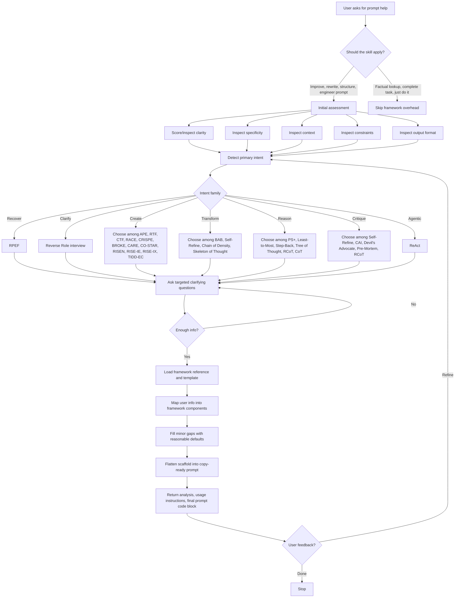
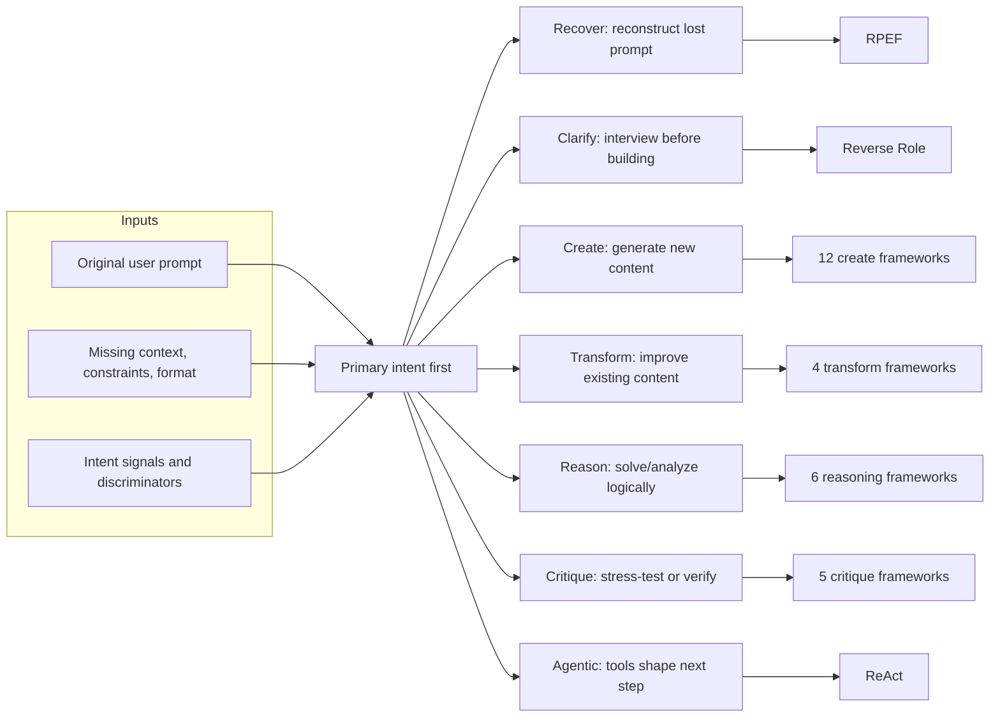
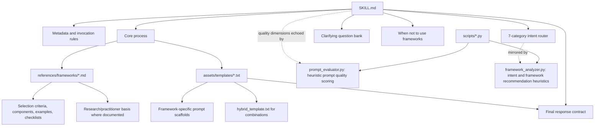
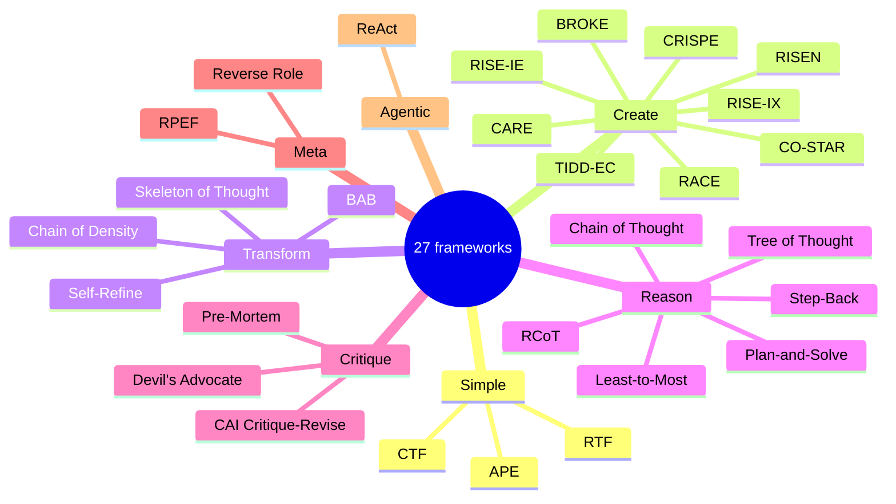

# Prompt Architect Skill Map

This map evaluates the `prompt-architect/` skill as copied into the global Cursor skills directory. It is a standalone architecture note and does not modify skill behavior.

## What It Is

`prompt-architect` is an eager, stateless Cursor skill for turning vague, incomplete, or under-structured prompts into executable prompts. Its control model is not "pick a favorite prompt format"; it first classifies the user's intent, then selects from 27 prompting frameworks, gathers missing requirements, applies a template/reference pair, and returns a copy-ready prompt with analysis.

Key metadata from `SKILL.md`:

- Invocation: `trigger-phrase`
- Body load: `eager`
- State model: `stateless`
- Portability: `public`
- Provenance: `ckelsoe/prompt-architect`, version `3.2.2`
- Trust tier: `vetted`
- Dependencies: none

## Flow And Control Logic

## Intent Router

## Substrates And Mechanisms

### Resource Inventory

- `SKILL.md`: canonical behavioral contract. Defines the 5 assessment dimensions, 7 intent categories, framework selection tables, clarification questions, application steps, output ordering, iteration loop, and skip conditions.
- `references/frameworks/`: 27 Markdown reference files. These are loaded on demand for deeper framework guidance, examples, selection criteria, and quality checklists.
- `assets/templates/`: 27 framework templates plus `hybrid_template.txt`. These are scaffolds for mapping user information into framework components, not necessarily text to paste verbatim into the final answer.
- `scripts/framework_analyzer.py`: optional heuristic implementation of the intent router and top-2 framework recommendation logic. It mirrors much of `SKILL.md` but is not invoked automatically by the skill text.
- `scripts/prompt_evaluator.py`: optional heuristic scorer for clarity, specificity, context, completeness, and structure. It echoes the initial-assessment concept but uses simple lexical rules.

## Workflow Phases

1. **Trigger and gate**: Activate for prompt engineering requests; skip for complete tasks, simple factual exchanges, "just do it" requests, and cases where structure adds no value.
2. **Assess prompt quality**: Inspect clarity, specificity, context, constraints, and output format to identify what is missing.
3. **Classify primary intent**: Route to recover, clarify, create, transform, reason, critique, or agentic before choosing a framework.
4. **Discriminate inside category**: Use signal tables and targeted discriminators, such as TIDD-EC vs CARE for separate do/don't lists vs combined rules and examples.
5. **Clarify progressively**: Ask 3-5 framework-specific questions at a time rather than collecting every possible detail up front.
6. **Apply scaffold**: Load the relevant template and reference, map known inputs into components, fill minor gaps conservatively, and combine frameworks only when needed.
7. **Present output**: Return analysis first, then usage instructions, then the revised prompt as the final fenced code block with nothing after it.
8. **Iterate**: Refine, switch, or combine frameworks based on feedback.

## Framework Families

## Notable Strengths

- **Intent-first routing** reduces template cargo-culting. The skill tells the agent to classify the job before selecting a framework.
- **Good anti-overhead guardrails** are explicit. The "When NOT to Use Frameworks" section prevents using heavy scaffolds for complete or simple requests.
- **Reference/template separation is healthy**. Framework docs provide reasoning and examples; templates provide fillable structure.
- **The output contract is copy-focused**. The final prompt must be flat text in a fenced block with no trailing commentary, which protects copy/paste usability.
- **Hybrid guidance is pragmatic**. It names useful combinations but warns that a focused hybrid beats using every section.

## Risks And Gaps

- **Scripts are optional and disconnected from runtime instructions**. The skill never instructs the agent to run `framework_analyzer.py` or `prompt_evaluator.py`; they are useful substrate, not an execution engine.
- **Heuristic scoring is shallow if over-trusted**. `prompt_evaluator.py` rewards surface cues like question words, numbers, and section markers; it can miss domain nuance.
- **Keyword intent detection can misroute ambiguous prompts**. `framework_analyzer.py` uses simple keyword scoring, defaults to `create`, and can tie on broad words like "analyze", "evaluate", or "review".
- **Template headers conflict with the final prompt rule if copied literally**. Templates are sectioned scaffolds, while `SKILL.md` says final revised prompts should not expose framework headers unless genuinely needed.
- **Section numbering has a minor duplicate**. `SKILL.md` labels both "Clarification Questions" and "Apply Framework" as section 4; harmless, but it can confuse references.

## Evaluation Conclusion

The skill is best understood as an intent router plus a library of framework-specific scaffolds. Its strongest mechanism is the staged pipeline: assess gaps, classify intent, select discriminators, clarify only what is missing, then flatten a scaffold into a copy-ready prompt. The main operational risk is mistaking the optional Python heuristics or visible template headers for the actual runtime behavior; the canonical behavior lives in `SKILL.md` and requires agent judgment.
